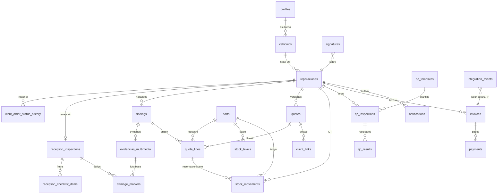

# Plan de mejora: flujo end-to-end del taller (DrCar / AutoMaster AI)

> Recepción → Diagnóstico → Cotización → Aprobación remota → Reparación e inventario → Control de calidad → Facturación y cobro → Entrega.
> Documento de producto + arquitectura. Fecha: 2026-10-14.

---

## 0. Punto de partida (qué hay hoy y qué cambia)

Revisado en el repo (`supabase/migrations/001–004`, `src/app/actions/workshop.ts`, `paint_sessions`):

| Hoy | Brecha respecto al flujo objetivo |
|---|---|
| `reparaciones` con 6 estados (`en_espera … completado`) y `updateRepairStatus` sin reglas | No hay recepción, aprobación, QC ni entrega. **Cualquiera puede mover a `listo_entrega`** |
| `presupuestos` + `presupuesto_detalles` (`part/labor/service`) | Sin versiones, sin enlace a hallazgos, sin aprobación parcial, sin firma |
| `evidencias_multimedia` (`is_before`) | Sin fase, sin visibilidad cliente/interna, sin marcado de daños. **Bucket `evidencias` con lectura pública (migración 004)** → fotos de clientes accesibles por URL |
| `paint_sessions.access_token` (UUID, 30 días) y `/paint-visualizer/s/[token]` | Patrón de *magic link* ya validado: se generaliza para el portal de aprobación |
| Sin inventario, sin facturación electrónica, sin pasarela para taller (`payments.ts` es de renta) | Módulos nuevos |
| Prisma cubre solo parte del esquema; SQL de Supabase cubre el resto | **Riesgo de deriva** → una sola fuente de verdad (ver §3.1) |

**Principios de diseño**

1. **Las reglas de negocio críticas viven en la base de datos** (trigger/RPC), no solo en la UI: quality gate, descuento de stock, inmutabilidad de lo firmado.
2. **Todo lo firmado es inmutable y verificable**: se firma un *snapshot* con hash, no una pantalla.
3. **Cada cambio de estado deja historial** (`work_order_status_history`): de ahí salen todas las métricas del Kanban.
4. **El cliente no instala nada**: enlace mágico → web responsiva.
5. **Integraciones detrás de adaptadores** (`AccountingProvider`, `PaymentProvider`, `MessagingProvider`) para no casarse con Siigo ni con un solo proveedor.

---

## 1. Máquina de estados de la OT (base del Kanban y de las reglas)

```
 RECIBIDO ──► DIAGNÓSTICO ──► ESPERANDO APROBACIÓN ──► APROBADO ──► EN REPARACIÓN ──► CONTROL CALIDAD ──► LISTO ENTREGA ──► ENTREGADO ──► CERRADO
                                  │  ▲                    │             │  ▲                │
                                  │  └── nueva versión ───┘             ▼  │                └─ falla QC → vuelve a EN REPARACIÓN
                                  ▼                              ESPERANDO REPUESTOS
                              RECHAZADO / CANCELADO            (sin stock; vuelve al reservar/recibir)
```

| Estado nuevo | Equivale a (estado actual) | Quién lo mueve | Guardas (transición permitida solo si…) |
|---|---|---|---|
| `recibido` | `en_espera` | Recepcionista | Inspección de recepción **firmada** por el cliente |
| `en_diagnostico` | `en_proceso` (inicio) | Técnico | Técnico asignado |
| `esperando_aprobacion` | — | Sistema (al enviar cotización) | Cotización vigente enviada |
| `aprobado` | — | Sistema (firma cliente) o recepcionista (aprobación presencial con firma) | Firma de aceptación registrada |
| `esperando_repuestos` | `esperando_repuestos` | Sistema | Reserva de stock con faltante |
| `en_reparacion` | `en_proceso` | Técnico | Stock reservado o ítems sin repuesto |
| `control_calidad` | — | Técnico | Todas las tareas aprobadas completadas |
| `listo_entrega` | `listo_entrega` | Técnico/Jefe de taller | **Acta de QC firmada y sin ítems bloqueantes fallidos** (trigger BD) |
| `entregado` | `completado` | Recepcionista | Factura emitida + pago registrado (o crédito autorizado) + firma de entrega |
| `cerrado` | — | Sistema | Entregado y conciliado |
| `cancelado` / `rechazado` | `cancelado` | Admin | Motivo obligatorio |

Migración: columna `status` se amplía y se mapea; las OT históricas conservan equivalencia sin pérdida.

---

## 2. Plan por módulo

### 2.1 Recepción digital
- **Inspección de ingreso** (`reception_inspections`): kilometraje, nivel de combustible, motivo del cliente, objetos de valor, **checklist configurable** (plantillas por tipo de vehículo: llanta de repuesto, gato, triángulos, herramientas, extintor, radio, alfombras, documentos…) con estado *presente / ausente / dañado* y cantidad.
- **Condición estética con fotos marcadas**: captura desde cámara del móvil/tablet (6 vistas guiadas: frente, trasero, laterales, tablero, baúl) + **anotación sobre la foto** (pin/círculo/trazo con severidad y nota). Coordenadas normalizadas (0–1) guardadas aparte de la imagen original → la foto original nunca se altera (valor probatorio).
- **Firma digital de entrada**: lienzo táctil en el dispositivo del taller + hash del acta. Genera PDF "Acta de recepción" y la envía al cliente por WhatsApp/correo.
- Mejora adicional: pre-llenado por placa (reutiliza `vehiculos`), OCR de placa opcional (fase posterior), cita → OT en un clic (`citas` ya existe).

### 2.2 Diagnóstico y cotización rápida
- **Hallazgos** (`findings`): el técnico, desde el móvil, registra sistema afectado, descripción, semáforo (verde/amarillo/rojo — reutiliza `urgency_level`), fotos/video y *parte + mano de obra sugeridas* (catálogo).
- **"Generar cotización"** (1 clic): convierte hallazgos seleccionados en `quote` v1 con líneas separadas por **Mano de obra** (horas × tarifa del catálogo de servicios) y **Repuestos** (SKU, cantidad, precio, disponibilidad en bodega). Cada línea conserva `finding_id` → el cliente ve *por qué* se cobra cada cosa (foto del hallazgo incluida).
- Totales: subtotal MO, subtotal repuestos, descuentos, impuesto (IVA configurable), total. Vigencia (`valid_until`).
- Recepcionista puede ajustar antes de enviar; cada edición posterior al envío crea **nueva versión** (la anterior queda `superseded`).

### 2.3 Aprobación remota por enlace
- `client_links`: token aleatorio de 256 bits, **solo se guarda el hash**, alcance (`quote_approval`, `progress`, `payment`), expiración, revocación. Evolución del patrón de `paint_sessions.access_token`.
- Envío por **WhatsApp** (Cloud API con plantilla *utility*; mientras tanto fallback `wa.me` como hoy) y **SMS/correo**. Ruta pública `/o/[token]`, responsiva, sin login.
- El cliente ve: resumen de hallazgos con fotos, líneas MO/repuestos, total, y puede **aprobar todo, aprobar por línea (parcial) o rechazar** con comentario.
- **Firma de aceptación con validez de registro**: dibujo de firma + nombre + documento + **OTP de 6 dígitos al teléfono registrado** (segundo factor) + registro **server-side** de `signed_at` (UTC), IP (`x-forwarded-for`), user-agent, hash SHA-256 del snapshot de la cotización (líneas, precios, totales, versión), texto legal aceptado y versión del texto. Se emite PDF de constancia con el hash.
- ⚠️ Validez legal: una firma electrónica simple + evidencia técnica suele ser admisible, pero **debe validarse con asesor legal local** (p. ej. Ley de Firma Electrónica de El Salvador si operan allí) y definir texto de términos, privacidad y retención.

### 2.4 Taller, inventario y trazabilidad
- **Catálogo y stock** (`parts`, `stock_levels`, `stock_movements`): ledger de movimientos (`receive`, `reserve`, `release`, `consume`, `return`, `adjust`); el saldo se deriva y se cachea en `stock_levels`.
- **Deducción automática** (recomendación): al **aprobar** se *reserva* stock (baja el disponible de inmediato); al **marcar instalado** el técnico se *consume* (baja el físico). Si falta stock → estado `esperando_repuestos` + `purchase_requests` al proveedor. Ejecutado en una RPC transaccional con `SELECT … FOR UPDATE` para evitar sobreventa entre OT concurrentes.
- Aprobación parcial: solo se reservan líneas aprobadas.
- **Avance con fotos**: el técnico sube fotos/video por tarea (cola offline en el PWA del técnico); marca cada evidencia como *visible al cliente*. Un *outbox* de notificaciones envía por WhatsApp: "Tu vehículo pasó a *En reparación*", "Frenos delanteros completados" + foto. Página de seguimiento `/o/[token]` con línea de tiempo en vivo (Supabase Realtime).
- Control de abuso: máx. N notificaciones/día por OT, horario permitido, *opt-in* registrado.

### 2.5 Control de calidad (Quality Gate)
- **Plantillas de QC** por tipo de servicio (`qc_templates` → `qc_template_items`) con ítems marcados `is_blocking`, `requires_photo`, `requires_measurement` (unidad, mín–máx). Ejemplos: torque de pernos de rueda (N·m, con rango), prueba de ruta (km mínimos), niveles de fluidos, fugas, presión de llantas, luces, testigos de tablero, limpieza.
- **Acta de QC** (`qc_inspections`) con resultados por ítem, evidencia y **firma del técnico responsable** (rol `technician`, el asignado a la OT o un jefe de taller; nunca el recepcionista).
- **Regla estricta**: `reparaciones.status → 'listo_entrega'` es rechazada por la **base de datos** si no existe un acta firmada vigente, sin ítems bloqueantes en falla. Si QC falla → OT vuelve a `en_reparacion` y se cuenta como *retrabajo* (métrica).
- Cualquier cambio en la OT posterior a la firma (nueva tarea, nuevo repuesto) **invalida** el acta (vuelve a `draft`) → hay que re-firmar.

```sql
-- Ejemplo de la guarda (migración 005, resumido)
CREATE OR REPLACE FUNCTION enforce_quality_gate() RETURNS trigger AS $$
BEGIN
  IF NEW.status = 'listo_entrega' AND OLD.status IS DISTINCT FROM 'listo_entrega' THEN
    IF NOT EXISTS (
      SELECT 1 FROM qc_inspections q
      WHERE q.repair_id = NEW.id AND q.status = 'signed' AND q.is_current
        AND q.signed_by IS NOT NULL
    ) THEN
      RAISE EXCEPTION 'QUALITY_GATE: acta de QC firmada requerida' USING ERRCODE = 'P0001';
    END IF;
    IF EXISTS (
      SELECT 1 FROM qc_results r JOIN qc_inspections q ON q.id = r.inspection_id
      WHERE q.repair_id = NEW.id AND q.is_current AND r.is_blocking AND r.result = 'fail'
    ) THEN
      RAISE EXCEPTION 'QUALITY_GATE: existen ítems bloqueantes fallidos' USING ERRCODE = 'P0001';
    END IF;
  END IF;
  RETURN NEW;
END $$ LANGUAGE plpgsql;

CREATE TRIGGER trg_quality_gate BEFORE UPDATE OF status ON reparaciones
  FOR EACH ROW EXECUTE FUNCTION enforce_quality_gate();
```
El `UPDATE` directo sobre `status` se restringe además por RLS a una RPC `transition_work_order(id, to_status, reason)` que valida la matriz de transiciones de §1 y escribe el historial.

### 2.6 Facturación y cobro
- Al pasar a `listo_entrega`, el sistema **pre-genera la factura** desde la cotización aprobada + extras autorizados (`invoices`).
- **Adaptador contable** (`AccountingProvider`): `createInvoice`, `voidInvoice`, `getStatus`, `syncCustomer`, `syncItems`. Implementaciones: **Siigo** (REST, OAuth/token) y otras (Alegra, QuickBooks, Odoo). **Validar cobertura por país**: para El Salvador la factura electrónica es el **DTE del Ministerio de Hacienda** (directo o vía proveedor certificado); Siigo aplica donde opera localmente (p. ej. Colombia). El adaptador permite empezar por un proveedor y sumar otros sin tocar el dominio.
- **Pasarelas** (`PaymentProvider`): `createCheckout`, `verifyWebhook`, `refund`. Candidatas: Wompi / PagaditoSV / Stripe / PayPal según país. Link de pago en el mismo portal `/o/[token]` + pago en mostrador (efectivo/POS) registrado manualmente. Webhooks **idempotentes** (`integration_events.idempotency_key`) y conciliación periódica.
- Entrega bloqueada hasta pago o crédito aprobado por rol autorizado (regla configurable).

### 2.7 Tablero Kanban y métricas
**Columnas** (una por estado visible): Recibido · Diagnóstico · Esperando aprobación · Esperando repuestos · En reparación · Control de calidad · Listo para entrega · Entregado (últimos 7 días).
- Tarjeta: placa/modelo, cliente, técnico, edad en columna (verde/amarillo/rojo según SLA), fecha prometida, banderas (⏳ sin aprobar >24 h, 📦 faltante, ❌ QC fallido, 💳 pendiente de pago).
- Reglas: arrastrar = llamar a `transition_work_order` (si la guarda falla, la tarjeta regresa con el motivo). **Límites WIP** configurables por columna. Actualización en tiempo real.
- **Métricas** (todas derivadas de `work_order_status_history`):

| Métrica | Cálculo | Para qué |
|---|---|---|
| Tiempo de permanencia por estado (P50/P90) | `lead(changed_at) − changed_at` por estado | Detecta cuellos de botella |
| Cuello de botella | columna con mayor `permanencia media × WIP` | Priorizar acción |
| Lead time total | recibido → entregado | Promesa al cliente |
| Tiempo de aprobación | enviado → firmado | Eficacia de cotización/WhatsApp |
| Tasa de aprobación (total/parcial/rechazo) | por cotización | Calidad de diagnóstico y precios |
| Retrabajo / falla QC | `qc_inspections` con fallos ÷ total | Calidad |
| Espera por repuestos | tiempo en `esperando_repuestos` | Compras/stock |
| Cumplimiento de fecha prometida | entregadas a tiempo ÷ total | Satisfacción |
| Utilización por técnico/bahía | horas reales ÷ horas disponibles | Capacidad |
| Ticket promedio MO vs repuestos | facturas | Rentabilidad |

---

## 3. Entregable (a) — Historias de usuario clave (Given-When-Then)

**R-1 · Recepción con checklist y fotos marcadas** (Recepcionista)
- *Dado* una OT en borrador con el vehículo seleccionado, *cuando* completo el checklist de accesorios y capturo las 6 fotos guiadas, *entonces* no puedo avanzar a firma hasta tener al menos las 6 vistas y todos los ítems del checklist respondidos.
- *Dado* una foto del parachoques, *cuando* marco un rayón con severidad "media" y nota, *entonces* se guardan coordenadas y nota vinculadas a la foto original sin modificar el archivo.
- *Dado* que el cliente no firma, *cuando* intento mover la OT a `recibido`, *entonces* el sistema lo rechaza con el mensaje "Firma de recepción requerida".

**R-2 · Firma de entrada** (Cliente en mostrador)
- *Dado* una inspección completa, *cuando* el cliente firma y confirma su nombre y documento, *entonces* se guarda la firma con timestamp UTC del servidor, hash del acta, se genera el PDF y la OT pasa a `recibido`.
- *Dado* una inspección firmada, *cuando* alguien intenta editar checklist o marcas, *entonces* el sistema lo impide (solo se permite un anexo con nueva firma).

**D-1 · Hallazgos desde el móvil** (Técnico)
- *Dado* una OT en `en_diagnostico`, *cuando* registro un hallazgo rojo con 2 fotos, *entonces* aparece en la lista de hallazgos de la OT con su semáforo y evidencia, disponible offline si no hay red y sincroniza al reconectar.

**C-1 · Cotización en un clic** (Recepcionista)
- *Dado* 3 hallazgos con servicios y repuestos sugeridos, *cuando* pulso "Generar cotización", *entonces* se crea la cotización v1 con líneas separadas de mano de obra (horas × tarifa) y repuestos (cantidad × precio), cada línea ligada a su hallazgo, con totales e impuestos calculados.
- *Dado* un repuesto sin stock, *cuando* se genera la cotización, *entonces* la línea muestra "sin stock – plazo estimado" sin bloquear el envío.
- *Dado* una cotización ya enviada, *cuando* modifico un precio, *entonces* se crea la versión 2, la v1 queda `superseded` y el enlace anterior muestra "cotización actualizada".

**A-1 · Aprobación remota** (Cliente)
- *Dado* un enlace de WhatsApp vigente, *cuando* lo abro en mi teléfono sin sesión ni app, *entonces* veo la cotización responsiva con hallazgos, fotos, líneas y total.
- *Dado* una cotización con 4 líneas, *cuando* apruebo 3 y rechazo 1, *entonces* solo se reservan las 3 y el total aprobado se recalcula.
- *Dado* que presiono "Firmar y aprobar", *cuando* ingreso el OTP recibido y dibujo mi firma, *entonces* se registran `signed_at` (servidor), IP, user-agent, hash del snapshot y texto legal aceptado, y la OT pasa a `aprobado`.
- *Dado* un enlace expirado o revocado, *cuando* lo abro, *entonces* veo un mensaje neutro sin datos del vehículo y se ofrece solicitar un nuevo enlace.
- *Dado* 5 intentos fallidos de OTP, *cuando* intento un sexto, *entonces* el enlace se bloquea 15 minutos.

**I-1 · Stock automático** (Sistema/Bodeguero)
- *Dado* una cotización aprobada con 2 filtros disponibles (stock 10), *cuando* se registra la aprobación, *entonces* se crean movimientos `reserve` y el disponible baja a 8 en la misma transacción.
- *Dado* un stock de 1 y una OT concurrente que reserva el mismo repuesto, *cuando* ambas aprueban a la vez, *entonces* solo una reserva tiene éxito y la otra pasa a `esperando_repuestos` con solicitud de compra.
- *Dado* un repuesto reservado, *cuando* el técnico lo marca instalado, *entonces* se registra `consume` y queda trazado a la OT, la línea y el técnico.
- *Dado* una OT cancelada tras aprobar, *cuando* se confirma la cancelación, *entonces* las reservas se liberan (`release`).

**T-1 · Avance con fotos al cliente** (Técnico / Cliente)
- *Dado* una tarea en curso, *cuando* subo una foto y la marco "visible al cliente", *entonces* el cliente recibe una notificación con la imagen y la ve en su línea de tiempo; las fotos internas nunca se exponen.
- *Dado* que el cliente no dio *opt-in* de WhatsApp, *cuando* hay un avance, *entonces* se envía por el canal permitido o solo se muestra en el portal.

**Q-1 · Quality gate** (Técnico responsable / Jefe de taller)
- *Dado* una OT en `control_calidad` sin acta firmada, *cuando* cualquier usuario (incluido admin) intenta pasarla a `listo_entrega` por UI o API, *entonces* la base de datos rechaza con `QUALITY_GATE` y la UI muestra qué falta.
- *Dado* el ítem bloqueante "torque de pernos" con rango 110–130 N·m, *cuando* registro 95 N·m, *entonces* el ítem se marca fallido, no permite firmar el acta como aprobada y la OT vuelve a `en_reparacion` con motivo.
- *Dado* un acta firmada por el técnico asignado, *cuando* se agrega una tarea nueva a la OT, *entonces* el acta se invalida y se exige nueva firma.
- *Dado* un usuario con rol recepcionista, *cuando* intenta firmar el acta de QC, *entonces* el sistema lo prohíbe (solo `technician` o jefe de taller).

**F-1 · Facturación** (Recepcionista / Contador)
- *Dado* una OT en `listo_entrega`, *cuando* confirmo la factura, *entonces* se envía al ERP vía adaptador con `idempotency_key`, se guarda el número/código de control y el PDF/XML, y el estado de la factura es consultable.
- *Dado* que el ERP responde error o timeout, *cuando* se reintenta, *entonces* no se duplica la factura y la OT muestra "Facturación pendiente" con reintento automático (backoff) y alerta tras N fallos.

**P-1 · Cobro** (Cliente)
- *Dado* una factura emitida, *cuando* el cliente paga desde el enlace, *entonces* el webhook verificado marca el pago, la OT queda apta para entrega y se envía el recibo; un webhook repetido no duplica el pago.
- *Dado* un pago pendiente, *cuando* el recepcionista intenta entregar, *entonces* el sistema exige pago o autorización de crédito de un rol facultado, con registro de quién autorizó.

**K-1 · Kanban y métricas** (Jefe de taller / Gerente)
- *Dado* el tablero, *cuando* arrastro una OT a una columna cuya guarda no se cumple, *entonces* la tarjeta regresa y se explica el motivo.
- *Dado* una OT con más de 24 h en `esperando_aprobacion`, *entonces* la tarjeta se marca en rojo y se sugiere reenviar el enlace.
- *Dado* un rango de fechas, *cuando* abro Métricas, *entonces* veo P50/P90 de permanencia por estado, WIP por columna y la columna señalada como cuello de botella.

---

## 4. Entregable (b) — Modelo de datos

### 4.1 Diagrama de relaciones



### 4.2 Entidades principales (nuevas y evolucionadas)

| Entidad | Campos clave | Notas |
|---|---|---|
| **reparaciones** *(existente → OT)* | + `order_number`, `status` ampliado, `promised_at`, `received_at`, `delivered_at`, `mileage_in`, `fuel_level`, `current_step_entered_at` | Trigger `enforce_quality_gate`; solo RPC cambia estado |
| **work_order_status_history** | `repair_id`, `from_status`, `to_status`, `changed_by`, `changed_at`, `reason` | Append-only; base de métricas |
| **reception_inspections** | `repair_id` (1:1), `mileage`, `fuel_level`, `customer_notes`, `signature_id`, `locked_at` | Bloqueada tras firmar |
| **checklist_templates / items** | `code`, `label`, `category`, `vehicle_type` | Configurable por taller |
| **reception_checklist_items** | `inspection_id`, `item_code`, `state` (present/absent/damaged), `qty`, `note` | |
| **damage_markers** | `inspection_id`, `evidence_id`, `x`, `y`, `shape` (jsonb), `severity`, `note` | Coordenadas normalizadas |
| **evidencias_multimedia** *(existente)* | + `phase` (reception/diagnosis/progress/qa/delivery), `visibility` (internal/customer), `taken_at`, `sha256` | Bucket **privado** + URLs firmadas |
| **findings** | `repair_id`, `system`, `description`, `urgency_level`, `created_by`, `suggested_service_id` | |
| **services_catalog** | `code`, `name`, `std_hours`, `hourly_rate` | Mano de obra estándar |
| **quotes** *(evolución de `presupuestos`)* | `repair_id`, `version`, `status` (draft/sent/approved/partial/rejected/superseded/expired), `subtotal_labor`, `subtotal_parts`, `tax`, `total`, `valid_until`, `snapshot_hash` | Una vigente por OT |
| **quote_lines** *(evolución de `presupuesto_detalles`)* | `quote_id`, `kind` (labor/part), `finding_id`, `part_id`, `service_id`, `qty`/`hours`, `unit_price`, `discount`, `tax_rate`, `approved` (bool/null) | Aprobación por línea |
| **signatures** | `purpose` (reception/quote_approval/qc/delivery), `subject_type`, `subject_id`, `signer_name`, `signer_doc`, `signer_role`, `image_path`, `document_hash`, `signed_at`, `ip`, `user_agent`, `otp_verified`, `legal_text_version` | Inmutable (sin UPDATE/DELETE) |
| **client_links** | `token_hash`, `scope`, `repair_id`, `quote_id`, `channel`, `expires_at`, `revoked_at`, `attempts`, `locked_until`, `last_used_at` | Generaliza `paint_sessions.access_token` |
| **parts** | `sku`, `name`, `cost`, `price`, `uom`, `min_stock`, `supplier_id` | |
| **stock_levels** | `part_id`, `location_id`, `on_hand`, `reserved` (disponible = on_hand − reserved) | Caché del ledger |
| **stock_movements** | `part_id`, `type` (receive/reserve/release/consume/return/adjust), `qty`, `repair_id`, `quote_line_id`, `user_id`, `created_at` | Append-only |
| **suppliers / purchase_requests** | pedido de faltantes ligado a OT | |
| **qc_templates / qc_template_items** | `is_blocking`, `requires_photo`, `requires_measurement`, `unit`, `min_value`, `max_value` | |
| **qc_inspections** | `repair_id`, `template_id`, `status` (draft/signed/failed), `is_current`, `inspector_id`, `signature_id`, `signed_at` | Se invalida al cambiar la OT |
| **qc_results** | `inspection_id`, `item_id`, `result` (pass/fail/na), `measured_value`, `evidence_id`, `is_blocking` | |
| **invoices** | `repair_id`, `quote_id`, `provider`, `external_id`, `number`, `control_code`, `status`, `total`, `pdf_url`, `xml_url`, `idempotency_key` | |
| **payments** | `invoice_id`, `provider`, `external_ref`, `amount`, `method`, `status`, `paid_at` | |
| **notifications** | `repair_id`, `channel`, `template`, `payload`, `status`, `provider_msg_id`, `attempts`, `sent_at` | Outbox + reintentos |
| **contact_consents** | `profile_id`, `channel`, `opted_in_at`, `source` | *Opt-in* WhatsApp/SMS |
| **integration_events** | `provider`, `direction`, `idempotency_key`, `payload`, `status` | Webhooks y llamadas ERP |
| **audit_log** | `actor`, `action`, `entity`, `entity_id`, `diff`, `at` | Cambios sensibles |

### 4.3 Reglas de integridad (resumen)
- `signatures`, `stock_movements`, `work_order_status_history`, `audit_log`: **append-only** (RLS sin UPDATE/DELETE).
- Una sola `quotes` vigente y una sola `qc_inspections.is_current` por OT (índices únicos parciales).
- `stock_levels.reserved ≤ on_hand` con `CHECK` y actualización en RPC bajo bloqueo de fila.
- RLS: staff por rol (`get_user_role()` ya existe); acceso del cliente **solo** vía RPC/handler que resuelve `token_hash` con rate limit — nunca políticas abiertas a `anon`.

---

## 5. Entregable (c) — Arquitectura técnica e integraciones

### 5.1 Decisión base: monolito modular sobre el stack actual
Se mantiene **Next.js 14 + Supabase (Postgres/Auth/Storage/Realtime) + Vercel**. No hace falta microservicios: el valor está en invariantes transaccionales en Postgres. Se organiza el código en módulos de dominio:

```
src/modules/
  work-orders/   (state machine, transition_work_order, historial)
  reception/     (inspección, checklist, marcas, firma)
  diagnosis/     (hallazgos) · quotes/ (versiones, líneas, snapshot)
  client-portal/ (/o/[token], OTP, aprobación, seguimiento)
  inventory/     (parts, stock ledger, reservas, compras)
  quality/       (plantillas, actas, gate)
  billing/       (AccountingProvider, PaymentProvider, webhooks)
  notifications/ (outbox, MessagingProvider, plantillas)
  analytics/     (vistas SQL de métricas)
```
Server Actions/Route Handlers delgados → servicios de dominio → RPC SQL para operaciones críticas.

### 5.2 Componentes y tecnologías recomendadas

| Necesidad | Recomendación | Motivo |
|---|---|---|
| Fuente de verdad del esquema | **Migraciones SQL de Supabase** + `supabase gen types`; retirar o regenerar `prisma/schema.prisma` | Hoy Prisma cubre solo parte → deriva |
| Estado y reglas críticas | Funciones PL/pgSQL + triggers (`transition_work_order`, `enforce_quality_gate`, `reserve_stock`) | Ninguna ruta (UI, API, script) puede saltarlas |
| Archivos | Supabase Storage **privado** + URLs firmadas de corta vida; eliminar política `anon` de la migración 004; compresión en cliente y SHA-256 | Las fotos de clientes hoy son públicas por URL |
| Anotación de fotos / firma | Canvas con **Konva** (o Fabric.js) + **signature_pad** | Ligero, táctil, coordenadas normalizadas |
| PWA técnico | **Serwist/next-pwa** + IndexedDB + Background Sync para subir evidencias offline | Talleres con WiFi irregular |
| Portal cliente | Rutas públicas `/o/[token]`, SSR, sin PWA obligatoria; manifest opcional | Cero fricción |
| Tiempo real | Supabase Realtime (Kanban, seguimiento cliente) | Ya incluido |
| Kanban | `@dnd-kit` + `transition_work_order` | Valida guardas en servidor |
| Jobs/colas | Outbox en Postgres + worker (Vercel Cron o Supabase Edge Functions + `pg_cron`); si crece, Inngest/Trigger.dev | Reintentos, backoff, idempotencia |
| Mensajería | `MessagingProvider`: **WhatsApp Business Cloud API (Meta)** con plantillas aprobadas (utilidad), SMS (Twilio/Infobip o proveedor local), correo (**Resend**, ya presente) | WhatsApp requiere opt-in y plantillas |
| OTP | Código de 6 dígitos, TTL 5 min, hash en BD, límite de intentos | Segundo factor de la firma remota |
| PDF de actas/constancias | Generación server-side (`@react-pdf/renderer` o Playwright) + hash guardado | Evidencia descargable |
| Facturación | `AccountingProvider` → **Siigo**, Alegra, QuickBooks, Odoo; **DTE (Hacienda SV)** si aplica | Validar según país de operación |
| Pagos | `PaymentProvider` → Wompi / Stripe / PayPal / POS | Según país y comisión |
| Observabilidad | Sentry + logs estructurados + panel de `integration_events` fallidos | Operar integraciones |
| Seguridad/privacidad | Hash de tokens, rate limiting (Upstash/Vercel), CSP existente, RLS por rol, `audit_log`, política de retención de fotos/firmas, consentimiento y aviso de privacidad | Datos personales + evidencia legal |

### 5.3 Flujos de integración clave

**Aprobación remota**
```
Recepcionista → quotes.send() → client_links (hash) + notifications(outbox)
Worker → WhatsApp/SMS con /o/<token>
Cliente → GET /o/<token> (valida hash, expiración, rate limit)
       → POST /o/<token>/otp → POST /o/<token>/sign
Servidor → INSERT signatures (IP, UA, timestamp servidor, hash snapshot)
        → RPC approve_quote(): estado OT=aprobado + reserve_stock() (misma transacción)
```

**Facturación y cobro**
```
transition → listo_entrega ─► billing.createInvoice(idempotency_key)
   AccountingProvider (Siigo/DTE/…) ─► invoices(external_id, número, PDF/XML)
   PaymentProvider.createCheckout ─► link en /o/<token>
Webhook (firma verificada, idempotente) ─► payments ─► habilita entrega
Job de conciliación nocturno compara invoices/payments vs. proveedor
```

### 5.4 Riesgos y mitigaciones
| Riesgo | Mitigación |
|---|---|
| Validez legal de firma y consentimiento | Validación con abogado local; texto/versión guardados; OTP + hash + metadatos |
| Fotos de clientes expuestas hoy | Bucket privado + URLs firmadas **en Fase 0** |
| Dependencia de un ERP/pasarela | Adaptadores + `integration_events` + pruebas de contrato |
| Sobreventa de repuestos | RPC transaccional con bloqueo + prueba de concurrencia |
| Rechazo de plantillas WhatsApp / ventana de 24 h | Fallback SMS/correo y enlace `wa.me` manual |
| Adopción por técnicos | PWA móvil, flujo de 3 toques, plantillas de checklist, capacitación corta |
| Migración de OT existentes | Mapeo de estados y *backfill* de historial con `created_at`/`updated_at` |

---

## 6. Hoja de ruta sugerida

| Fase | Duración (est.) | Alcance | Criterio de salida |
|---|---|---|---|
| **0 · Fundaciones** | 1–2 sem | Máquina de estados + historial + `transition_work_order`; storage privado; `signatures`; `client_links`; outbox; unificar fuente de esquema | Ninguna OT cambia de estado fuera de la RPC; fotos no accesibles sin URL firmada |
| **1 · Núcleo de valor** | 3–4 sem | Recepción digital + hallazgos + cotización 1 clic + portal de aprobación con OTP/firma + Kanban básico | Una OT completa de recepción a aprobación sin papel |
| **2 · Taller y calidad** | 3–4 sem | Inventario (reserva/consumo) + avance con fotos + notificaciones + **Quality Gate** + PWA técnico offline | `listo_entrega` imposible sin acta firmada (prueba automatizada) |
| **3 · Dinero** | 3–4 sem | Adaptador contable (primer proveedor) + pasarela + entrega condicionada a pago | Factura emitida y pago conciliado de punta a punta |
| **4 · Inteligencia operativa** | 2–3 sem | Métricas de permanencia/cuellos de botella, WIP limits, SLA, segundo ERP | Tablero con P50/P90 y alertas de envejecimiento |

**KPIs de éxito del programa**: −30 % lead time recepción→entrega; tiempo medio de aprobación < 4 h; ≥ 70 % de aprobaciones por enlace; 0 entregas sin QC firmado; disputas por daños preexistentes → 0 sin evidencia; discrepancia de inventario < 2 %.

---

## 7. Decisiones abiertas (necesito confirmación para pasar a diseño detallado)
1. **País/fiscalidad** de operación (define DTE vs. Siigo vs. otro ERP y pasarela).
2. **Reserva vs. consumo** de stock: ¿se acepta reservar al aprobar y consumir al instalar (recomendado)?
3. **Quién puede firmar el QC**: ¿solo el técnico asignado o también un jefe de taller?
4. **Pago previo a entrega**: ¿obligatorio, o se permite crédito con autorización?
5. **WhatsApp**: ¿cuenta Business ya verificada o arrancamos con enlace `wa.me` + SMS?
